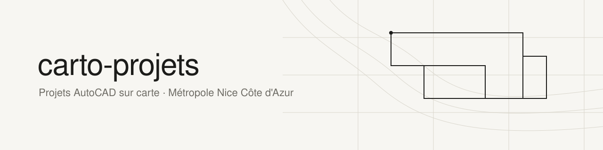

carto-projets verse des projets AutoCAD (ZIP eTransmit) sur une carte ArcGIS de la Métropole Nice Côte d'Azur. Le moteur est écrit en Rust compilé en WebAssembly et les pages sont statiques, publiées sur GitHub Pages.

Page du projet : <https://ninjathune-human.github.io/carto-projets/>

Le dossier `corpus/` contient des fichiers de clients : il n'est jamais versionné.

## Campagne de mesure (T11)

Tout ce qui suit se lance depuis la racine du dépôt. Les ZIP, les DXF et les CSV bruts restent dans `corpus/`, qui n'est jamais versionné : seuls les rapports Markdown anonymisés (`P01`, `P01-1`…) peuvent être publiés.

### Disposition du corpus

- `corpus/zips/` : les ZIP eTransmit (15 à 20), un fichier `.zip` par projet.
- `corpus/ref/<nom du ZIP sans .zip>/<chemin du DWG dans le ZIP>.dxf` : la référence. Convertir chaque DWG avec ODA File Converter en DXF 2018 ASCII, en gardant l'arborescence du ZIP (option « récursif »). Exemple : le DWG `Plans/Façade.dwg` du ZIP `Villa.zip` devient `corpus/ref/Villa/Plans/Façade.dxf`. `reference.py` en déduit le ZIP et le chemin du DWG ; une autre disposition fait échouer la jointure des lecteurs.
- `corpus/resultats/` : tous les CSV de lecteurs et les rapports. `comparer.py` lit tous les `*.csv` de ce dossier qui ont une colonne `lecteur`.
- `data/limite_metropole.geojson` : contour de la Métropole en WGS84 (EPSG:4326), à déposer pour `emprises.py`.

### Commandes

1. Lecteur natif acadrust (écrit `acadrust.csv` et `emprises.csv` dans le dossier de sortie) :
   `cargo run --release -p carto-bench --bin bench -- mesurer corpus/zips corpus/resultats`
2. Lecteur libredwg-web (installer d'abord les dépendances : `npm ci --prefix essais/libredwg`) :
   `node essais/libredwg/mesurer.mjs corpus/zips corpus/resultats/libredwg.csv`
3. Référence ezdxf (installer d'abord les dépendances : `pip install -r tools/requirements.txt`) :
   `python3 tools/reference.py corpus/ref corpus/resultats/reference.csv`
4. Lecteur acadrust dans le navigateur : ouvrir la page `essais/banc/` du site publié (PC, puis iPad), y déposer les ZIP, cliquer sur « Copier en CSV » et enregistrer le contenu du presse-papiers dans `corpus/resultats/acadrust-wasm.csv`. Ce fichier doit rester dans `corpus/resultats/` : le comparateur l'anonymise, alors que le coller dans un rapport publierait les noms de fichiers des clients.
5. Comparaison des lecteurs à la référence (écrit aussi `corpus/resultats/correspondance.csv`, identifiants anonymes et noms réels, non versionné) :
   `python3 tools/comparer.py corpus/resultats corpus/resultats/lecteurs.md`
6. Emprises par rapport au contour de la Métropole (utilise le même `correspondance.csv`, donc les mêmes identifiants) :
   `python3 tools/emprises.py corpus/resultats/emprises.csv data/limite_metropole.geojson corpus/resultats/emprises.md`

Les trois lecteurs comptent les entités de l'espace objet seulement, hors `ATTRIB`, `SEQEND` et `VERTEX`. Les CSV bruts gardent les noms de types propres à chaque lecteur ; `comparer.py` les ramène aux types DXF d'ezdxf par une seule table (les objets personnalisés et proxys sont regroupés sous `PERSONNALISEE`). Les rapports `lecteurs.md` et `emprises.md` se copient ensuite dans `docs/phase0/`.

## Phase 1a : import de projets et visionneuse

### Ce que fait l'import

L'import prend un ZIP eTransmit, retient le dessin maître, lit ses xréfs et produit une scène vectorielle : traits et surfaces colorés, rangés par calque dans l'ordre d'affichage du dessin. Les calques éteints, gelés, non imprimables ou nommés `Defpoints` sont masqués. La tolérance de corde est de 1 mm réel.

Le moteur ne lit que les types suivants : LINE, LWPOLYLINE, POLYLINE 2D et 3D, ARC, CIRCLE, ELLIPSE, SPLINE, HATCH et MPOLYGON pleins (un dégradé devient une couleur pleine), SOLID, TRACE, INSERT (MINSERT, imbrication, miroir) et xréfs.

### Systèmes reconnus

Le système de coordonnées du plan est reconnu par l'emprise de ses entités, comparée à celle de la Métropole : Lambert 93, CC43, CC44, Lambert II étendu, Lambert III Sud et Lambert III carto. Un plan sans système reconnu est refusé avec le message « Plan non géoréférencé : aucun système reconnu (Lambert 93, CC43, CC44, Lambert II étendu, Lambert III Sud ou carto). ».

Ce qui déborde de la Métropole n'est jamais une erreur : tout est importé et reste visible sous le voile.

### Visionneuse et dépôt sur la carte

- `essais/visionneuse/` : page qui affiche un plan sans fond de carte. Déposer le ZIP, choisir le dessin maître si plusieurs sont possibles, puis parcourir le plan.
- Sur la carte (`essais/carte/`) : déposer un ZIP directement sur la carte pour y verser le projet.

Le code partagé par les deux pages est dans `essais/commun/`.

### Outils en ligne de commande

- Scène SCN1 d'un ZIP : `cargo run --release -p carto-bench --bin bench -- scene <zip> <sortie.scn>`
- Aperçu PNG d'une scène : `python3 tools/apercu_scene.py <scene.scn> <apercu.png>`

L'aperçu demande Pillow et numpy : `pip install -r tools/requirements.txt`.

### Limites de la phase 1a

Les textes, les cotes (DIMENSION), les lignes de repère (MULTILEADER), les hachures à motif, les types de ligne et les WIPEOUT ne sont pas dessinés. Ils sont comptés comme ignorés, par nom de type, dans le rapport d'import. Ils sont prévus pour la phase 1b.

### Attribution

La conversion de Lambert II étendu et de Lambert III utilise la grille de changement de repère NTF vers RGF93 `fr_ign_ntf_r93.tif`, produite par l'IGN, publiée sous Licence Ouverte Etalab 2.0 et distribuée via OSGeo/PROJ-data. Elle est versionnée dans `crates/georef/data/`.
